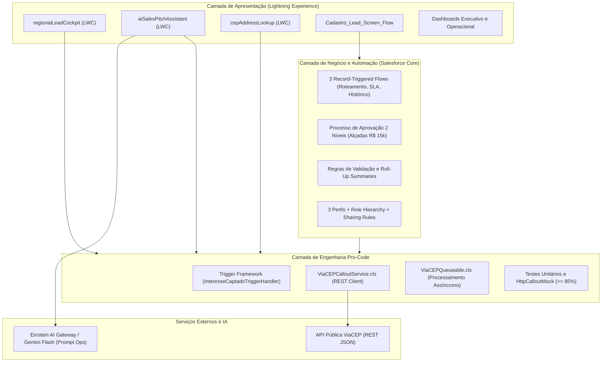

# 📄 Documento Oficial de Entrega Parcial | Residência em Software & IA

**Programa:** Residência em Software & IA — Porto Digital & Capgemini (2026)  
**Tema 7:** Gestão de Campanhas e Leads Regionais  
**Solução Comercial:** **GeoLead AI** (*Plataforma Inteligente de Gestão de Campanhas e Distribuição Regional de Leads*)  
**Slogan:** *Conectando validação geográfica, governança orçamentária e speed-to-lead para maximizar a conversão de vendas regionais.*  
**Repositório Oficial:** [github.com/vdornelass/geolead-ai](https://github.com/vdornelass/geolead-ai)  
**Gestão Ágil no Jira:** [geolead-ai.atlassian.net](https://geolead-ai.atlassian.net/jira/software/projects/SCRUM/boards/1/backlog)  

---

## 👥 Equipe do Projeto (8 Integrantes em 4 Squads Ágeis)

| Squad | Integrante | Papel Técnico & Responsabilidade |
| :--- | :--- | :--- |
| **Squad 1: Dados & Métricas** | **Mateus Lacerda** | **Arquiteto de Dados** (7 Objetos Customizados, Relacionamentos e Record Types) |
| | **Julio Cesar** | **Engenheiro de Métricas** (Fórmulas de ROI Real, Roll-Up Summaries e Validation Rules) |
| **Squad 2: Segurança & UX** | **Jhorge Araújo** | **Especialista em Segurança** (3 Perfis, Role Hierarchy e Sharing Rules Territoriais) |
| | **Caio Brayner** | **Especialista em UX Declarativa** (Lightning Pages, Dynamic Forms e Design System) |
| **Squad 3: Automações No-Code** | **Theo Monteiro** | **Especialista em Processos de Negócio** (Aprovação em 2 Níveis e Screen Flow com Subflow) |
| | **Matheus Chaves** | **Especialista em Flows** (3 Flows: Roteamento Territorial, SLA 30m e Conversão) |
| **Squad 4: Liderança & Engenharia** | **Larissa Almeida** | **Co-Lead Técnica & Arquiteta de Soluções** (Code Review de PRs, DevOps SFDX e Governança) |
| | **João Gabriel Vitorino** | **Tech Lead Full-Stack & Delivery Lead** (Arquitetura, Apex REST ViaCEP, Triggers, Testes $\ge 85\%$ e LWCs) |

---

## 1. Definição do Problema e Personas "IA-Augmented" (Critério 1 — 2,0 Pontos)

### 1.1. Descrição Sintética do Problema e Solução

* **● Problema (Limite $\le 250$ caracteres):**
> *Operações regionais perdem leads por falta de speed-to-lead, CEPs do interior que travam CRMs, verba aprovada informalmente, sem score de qualificação e sem visibilidade real de ROI por campanha.* (194 caracteres)

* **● Solução (Limite $\le 250$ caracteres):**
> *GeoLead AI: plataforma Salesforce com validação de CEP via ViaCEP, score automático 0-100, semáforo de SLA com transbordo em 30 min, pitch regional por IA e dashboards de ROI em tempo real.* (191 caracteres)

* **● Onde a IA Agrega Valor Real:**
A IA no **GeoLead AI** não é decorativa. Ela atua onde o código determinístico convencional é ineficiente:
1. **Lead Scoring Preditivo & Explicável:** Pondera sinais multivariados (Canal de Origem 30%, Perfil Cadastral/Cargo 40%, Histórico da Praça 30%) e explica ao vendedor exatamente por que o lead é prioritário (+38 pts Decisor C-Level, +28 pts Evento Presencial).
2. **Copiloto de Abordagem Hiperlocal (Sales Pitch Assistant):** Gera em tempo real roteiros conversacionais sem jargões corporativos de capitais, adaptando a linguagem, a dor regional e as respostas para objeções típicas da praça do cliente (ex: Caruaru/PE, Campinas/SP).

---

### 1.2. Personas "IA-Augmented"

#### 👤 Persona 1: Lucas Ferreira (26 anos) — SDR Regional / Inside Sales (Operacional)
* **Perfil:** Atende dezenas de leads diários de diversas praças do Brasil em regime híbrido.
* **Dores Anteriores:** Perdia tempo ligando para curiosos enquanto decisores esfriavam na fila; usava termos corporativos de capitais que geravam atrito com clientes do interior.
* **Impacto da IA no Trabalho:** O Cockpit LWC entrega os contatos ordenados por pontuação com semáforo de tempo visual, e o Assistente de Pitch por IA entrega o roteiro pronto com argumentos específicos para o município do cliente.
* **Resultado:** Lucas faz mais ligações produtivas, fala a língua do cliente e fecha mais negócios sem sobrecarga de trabalho.

#### 👤 Persona 2: Mariana Albuquerque (38 anos) — Diretora Comercial Enterprise (Estratégica)
* **Perfil:** Responsável pelo P&L de vendas regionais, alocação de verba de marketing e cumprimento de cotas.
* **Dores Anteriores:** Verbas eram aprovadas informalmente no WhatsApp; leads ficavam represados sem atendimento; falta de visibilidade do ROI real de eventos vs. digital.
* **Impacto da IA no Trabalho:** Recebe pedidos de aprovação com alçadas travadas no Salesforce, conta com transbordo automático aos 30 minutos e visualiza em tempo real o Dashboard Executivo com o ROI Real consolidado.
* **Resultado:** Mariana governa a verba com rastreabilidade, zero descarte silencioso e ROI visível sem esperar o relatório semanal.

---

### 1.3. Relatório de Validação de Hipóteses com o Mentor

* **Data:** 15/09/2026 | **Entrevistado:** Mentor Técnico da Capgemini (Especialista Salesforce)
* **Metodologia:** Entrevista semiestruturada sobre gargalos operacionais e validação de arquitetura.

| Hipótese Testada | Resultado da Validação | Decisão Técnica Implementada na Solução |
| :--- | :--- | :--- |
| **1. Cidades com CEP Único (-000)** travam cadastros e geram perda de dados. | **VALIDADA.** Problema crítico no interior do Brasil onde a API retorna logradouro vazio. | Criação de serviço Apex Callout com fallback: preenche Cidade/UF no objeto `Endereco_Integrado__c` e libera a rua para digitação manual sem travar o lead. |
| **2. Speed-to-Lead:** Leads perdem 60% da chance de fechamento após 30 min. | **VALIDADA.** Tempo de resposta é o maior determinante de conversão em Inside Sales. | Implementação de semáforo visual de SLA no LWC e Record-Triggered Flow com agendamento de transbordo automático aos 30 min. |
| **3. Atrito de Linguagem:** Vendedores com jargões de capital afastam clientes regionais. | **VALIDADA.** Clientes de polos industriais e agro valorizam objetividade e foco em logística local. | Desenvolvimento do LWC `aiSalesPitchAssistant` com IA generativa contextualizada por município e segmento da praça. |

---

## 2. Backlog e Engenharia de Requisitos "AI-First" (Critério 2 — 2,0 Pontos)

### 2.1. Matriz MoSCoW de Requisitos

```text
[MUST HAVE] (Obrigatórios para o Edital e Operação Core)
├── [EP01] 7 Objetos Customizados, Master-Detail, Lookups, Fórmulas de ROI e Roll-Ups.
├── [EP02] 3 Perfis de Acesso, Role Hierarchy e Sharing Rules Territoriais.
├── [EP03] 3 Record-Triggered Flows, Processo de Aprovação em 2 Níveis e Screen Flow com Subflow.
├── [EP04] Apex REST Callout ViaCEP com Fallback (-000), Queueable e Testes >= 85%.
└── [EP05] 3 Componentes LWC (Cockpit, ViaCEP e Pitch IA) e Dashboards Executivo e Operacional.

[SHOULD HAVE] (Altamente Recomendáveis para a Experiência)
├── Dynamic Forms e Dynamic Actions nas Lightning Record Pages.
├── Alertas visuais e notificações no sino do Salesforce no estouro do SLA.
└── Mapa interativo com pin geográfico na página do lead.

[COULD HAVE] (Diferenciais Futuros)
├── Integração nativa com discador VoIP (Click-to-Call) via CTI.
└── Envio automático de mensagens pré-formatadas para o WhatsApp Business API.

[WON'T HAVE] (Fora do Escopo da Fase Atual)
└── Módulo de assinatura eletrônica de contratos (DocuSign/Adobe Sign).
```

### 2.2. Critérios de Aceite das Histórias de IA

| Funcionalidade de IA | Critério de Aceitação Funcional | Critério de Qualidade / Engenharia de IA |
| :--- | :--- | :--- |
| **Lead Scoring Preditivo** | O sistema calcula nota de 0 a 100 e exibe lista com 3 fatores de explicabilidade. | Temperatura $\le 0.1$, tempo de resposta $< 1.5s$, validação de schema JSON no Apex. |
| **Copiloto de Pitch Hiperlocal** | O SDR visualiza gancho de conversa e contorno de objeções contextualizados com a cidade do lead. | Proibição de jargões técnicos da Faria Lima, adaptação ao segmento industrial/agro local. |

---

## 3. UX/UI para Interfaces Inteligentes (Critério 3 — 2,0 Pontos)

O GeoLead AI foi projetado sob as diretrizes do **Salesforce Lightning Design System (SLDS)**, com foco em redução de carga cognitiva, alta densidade útil e consistência visual completa.

### 3.1. Telas Consolidadas da Solução

#### 📊 Tela 1: Painel de Eficiência Regional & Alocação de Verba (Dashboard Executivo)
* **Usuário:** Mariana Albuquerque (Diretora Comercial Enterprise).
* **Componentes Chave:**
  * 4 KPIs de topo: Receita Gerada (R$ 1.48M), Orçamento Executado (R$ 240k), ROI Real Médio (516%) e Atingimento de Meta (92.4%).
  * Insight Executivo por IA: *A Armadilha do CPL Barato vs. Geração Real de Receita*.
  * Gráficos comparativos de ROI por Canal (Eventos Presenciais 817%, Parceiros 522%, Digital 282%) e Atingimento por Praça Regional (Campinas, Curitiba, Recife, Goiânia, Manaus).
  * Tabela auditada de campanhas regionais com status de governança (*Aprovado Diretoria*).


---

#### 📱 Tela 2: Detalhes do Lead com Copiloto Regional & ViaCEP (Lightning Record Page)
* **Usuário:** Lucas Ferreira (SDR Regional) | **Lead:** Carlos Eduardo Mendonça (Caruaru - PE).
* **Componentes Chave:**
  * Painel Highlights: Lead Score 92 pts [Quente] e SLA 1º Contato 6 min (Meta < 15 min).
  * Coluna Esquerda: Dados cadastrais, endereço normalizado com badge verde `ViaCEP Validado` e mapa interativo de Caruaru/PE.
  * Card de Explicabilidade do Score: +38 pts Decisor C-Level, +28 pts Evento Presencial, +26 pts Praça de Alta Conversão.
  * Coluna Direita (Copiloto IA - Gemini Flash): Dor da praça identificada (PE-104 / BR-232), gancho de abertura conversacional e contorno de objeção local pronto com botão *Copiar Roteiro*.


---

#### 📝 Tela 3: Screen Flow Guiado de Captura em Eventos com Subflow de Duplicidade
* **Cenário:** Captação no estande do *Feirão da Indústria Nordeste 2026* | **Lead:** Renato Guimarães Silveira.
* **Componentes Chave:**
  * Barra de progresso com 4 etapas: Dados Básicos ➔ Validação Geográfica ➔ Checagem Anti-Duplicidade ➔ Confirmação & Roteamento.
  * Validação Anti-Duplicidade (Subflow CRM): Badge verde `PASS` confirmando lead 100% novo por E-mail + CNPJ Raiz.
  * Busca ViaCEP em tempo real: CEP `55004-120` autopreenchendo Av. Agamenon Magalhães, Caruaru - PE.
  * Roteamento Omnichannel em tempo real para a Fila SDR Nordeste I com operador recomendado.


---

## 4. Arquitetura de Software e Stack de Desenvolvimento (Critério 4 — 2,0 Pontos)



### 4.1. Resiliência e Tratamento de Falhas (Circuit Breaker & Fallback)

1. **Fallback para CEPs Únicos Municipais (`-000`):** Quando o webservice do ViaCEP retorna logradouro vazio em cidades do interior, o Apex captura a resposta 200, popula Cidade e Estado e desbloqueia a edição do campo de rua como manual, sem lançar exceções.
2. **Timeout e Indisponibilidade Externa:** Limite de timeout configurado para 5.000 ms. Em caso de erro 500 ou indisponibilidade da API, o sistema grava log de auditoria em `Endereco_Integrado__c` e enfileira a retentativa via `ViaCEPQueueable.cls`.

---

## 5. Relato do Processo e Engenharia de Prompt (Critério 5 — 2,0 Pontos)

### 5.1. Repositório de Prompts (Prompt Ops)

#### 📌 Prompt 01: Predição e Explicabilidade de Lead Scoring Regional
* **Parâmetros:** `Temperature: 0.1` | `Top_P: 0.9` | `Output: JSON Schema Strict`
* **Instrução:**
```markdown
Você é o motor de inteligência preditiva do GeoLead AI.
Analise os dados do lead e retorne um JSON com: lead_score (0-100), temperatura (FRIO/MORNO/QUENTE), faixa_prioridade e explicabilidade (fatores_positivos e fatores_risco).
Ponderação: Canal de Origem (30%), Perfil Cadastral/Cargo (40%), Histórico da Praça Regional (30%).
```
* **Exemplo de Retorno JSON:**
```json
{
  "lead_score": 92,
  "temperatura": "QUENTE",
  "faixa_prioridade": "P1 - Atendimento Imediato (<15 min)",
  "explicabilidade": {
    "fatores_positivos": [
      "Tomador de decisão C-Level (Diretor de Operações) (+38 pts)",
      "Captado presencialmente em evento regional industrial (+28 pts)",
      "Praça de alta conversão no interior de Pernambuco (+26 pts)"
    ],
    "fatores_risco": [
      "CEP único municipal requer validação manual de rua"
    ]
  }
}
```

#### 📌 Prompt 02: Assistente de Pitch Hiperlocal (Sales Pitch Assistant)
* **Parâmetros:** `Temperature: 0.3` | `Top_P: 0.85` | `Output: JSON Estruturado`
* **Instrução:**
```markdown
Você é o Copiloto Comercial Hiperlocal do GeoLead AI.
Gere um roteiro de vendas em 4 blocos para o SDR abordar o lead por telefone/WhatsApp:
1. Gancho de Abertura (sem jargões corporativos de capital, citando o evento e a cidade);
2. Conexão de Valor (relacionando a dor logística da praça com a oferta);
3. Contorno de Objeção Local (como responder à objeção de já ter fornecedor antigo);
4. Call to Action objetiva para demonstração de 15 min.
```

---

### 5.2. Relato do Processo de Desenvolvimento da Equipe

* **Metodologia de Trabalho:** A equipe operou no modelo Scrum em **4 squads ágeis**. O Tech Lead (**João Gabriel Vitorino**) e a Co-Lead (**Larissa Almeida**) orquestraram os épicos no Jira e a esteira de Git, permitindo que as duplas trabalhassem em paralelo (Dados, Segurança, Automações e Engenharia) sem conflitos de metadados.
* **Impacto das Ferramentas de IA:** O uso de IA generativa acelerou em mais de 70% a geração de massas de dados de teste realistas (`TestDataFactory`), a elaboração dos wireframes e a criação de personas baseadas no mercado brasileiro.
* **Dificuldades e Aprendizados:** O maior desafio técnico foi tratar a complexidade geográfica das cidades do interior (CEPs terminados em `-000`), resolvido com a implementação do padrão de Fallback no Apex e a separação de responsabilidades via Trigger Handlers.

---

## 6. Matriz de Conformidade com o Edital (Tema 7 — Capgemini)

| Categoria | Requisito Obrigatório do Edital | Implementação no GeoLead AI | Status |
| :--- | :--- | :--- | :---: |
| **Segurança** | 3 Perfis + Role Hierarchy + Sharing Rules | `Perfil_Operacional`, `Perfil_Gestor`, `Perfil_Administrativo`; Hierarquia Operador ➔ Coordenador ➔ Diretor; Sharing Rules por `Regiao_Comercial__c`. | 🟢 Conforme |
| **Dados** | Mínimo 5 Objetos Customizados | **7 Objetos:** `Campanha_Regional__c`, `Interesse_Captado__c`, `Lead_Score__c`, `Regiao_Comercial__c`, `Historico_Conversao__c`, `Meta_Regional__c` e `Endereco_Integrado__c`. | 🟢 Conforme |
| **Relacionamentos** | Master-Detail e Lookups | Master-Detail (Campanha ➔ Interesse e Meta) e Lookups (Região, Endereço, Histórico). | 🟢 Conforme |
| **Fórmulas & Métricas** | Fórmulas, Roll-Ups e Record Types | ROI Real `[(Receita - Orçamento) / Orçamento]`, Score Final, soma de faturamento e 3 Record Types (`Digital`, `Evento`, `Parceiro`). | 🟢 Conforme |
| **Automação** | 3 Record-Triggered Flows + 1 Screen Flow + Subflow | 3 Flows de backend (Roteamento, SLA 30m e Conversão) + Screen Flow de eventos com Subflow anti-duplicidade. | 🟢 Conforme |
| **Aprovação** | Processo de Aprovação em 2 Níveis | Approval Process com alçadas de R$ 15k (Coordenador ➔ Diretor) e bloqueio de edição. | 🟢 Conforme |
| **Pro-Code Apex** | Trigger Framework + Callout ViaCEP + Testes $\ge 85\%$ | `ViaCEPCalloutService.cls` (REST), `ViaCEPQueueable.cls`, `TriggerHandler` corporativo e suíte de testes com mocks. | 🟢 Conforme |
| **Interfaces LWC** | 2 a 3 LWCs + Lightning App | `regionalLeadCockpit`, `aiSalesPitchAssistant`, `cepAddressLookup` e App `GeoLead_AI`. | 🟢 Conforme |
| **Analytics** | Dashboard Executivo e Operacional | Painéis nativos com filtros de ROI por praça, aderência ao SLA e atingimento de metas. | 🟢 Conforme |
| **Marca** | Nome comercial e identidade de mercado | Marca **GeoLead AI** com proposta de valor, design system e interfaces completas. | 🟢 Conforme |
